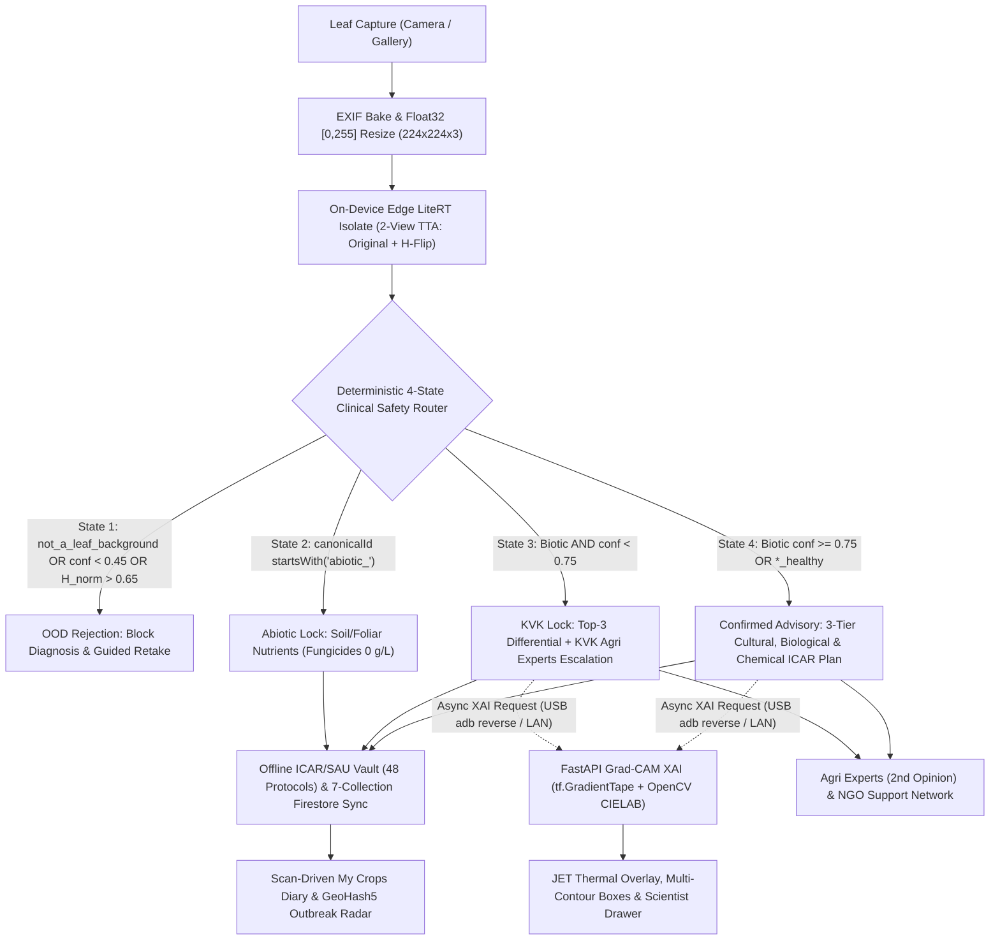

<div align="center">

<!-- Animated Top Wave Header -->


<br />


<br /><br />

<!-- Animated Typing Subtitle -->


<br />

<!-- Shields.io Badge Strip -->
<p>
  
  
  
  
  
  
  
  
  
</p>

<br />

<!-- Prominent Download APK CTA -->
<a href="https://github.com/dhruvhadal/FloraX/releases/latest">
  
</a>

<p><sub><em>Universal arm64-v8a &amp; armeabi-v7a Release APK distributed via GitHub Releases to keep repository clones lightweight.</em></sub></p>

</div>

---

## 1. Hackathon Problem Alignment (`Srujan 2026 — Track T1 | AI-05`)

> **Srujan 2026 (in association with L&T EduTech) — Track T1: Artificial Intelligence (AI) | Problem AI-05: Crop Disease Identification**  
> **Problem & Task:** Early identification of visible crop diseases from field leaf imagery and delivery of institutionally approved treatment advisories to protect smallholder yields and prevent indiscriminate agrochemical usage.

| Core Challenge (AI-05) | How KisanSetu Solves It in Production |
|---|---|
| **Early Visible Disease Detection** | On-device **45-class** `EfficientNetV2-B0` FP16 LiteRT classifier (`florax_v2_45c_fp16.tflite`, `11.41 MB`) executes **2-View TTA** inside a background Dart isolate in `< 200 ms`, paired with async **Keras `tf.GradientTape` Grad-CAM** (`global_avg_pool.input`) and OpenCV HSV/CIELAB lesion area quantification (`2.4%–88.0%`). |
| **Offline Rural Usability** | Zero-network core: uncompressed memory-mapped LiteRT weights, **48 bundled ICAR/SAU protocols** (`offline_icar_protocols.json`, `100%` class coverage), unlimited Cloud Firestore SQLite persistence, local `SharedPreferences` queues, and a 3-tier GPS reverse-geocoding fallback. |
| **Approved ICAR/SAU Advisory** | Every biotic and abiotic condition maps 1-to-1 to institutionally verified **3-Tier IPM Plans** (Tier 1 Cultural Sanitation, Tier 2 Biological / `AgriSage Organics`, Tier 3 ICAR/CIB&RC Chemical with 15L tank dosage, PHI & PPE) localized across **English, हिन्दी, and मराठी** with instant TTS audio guidance. |
| **Safe Chemical Lockouts** | A deterministic **4-State Clinical Safety Router** (`ClinicalDiagnosisDecision`) prevents toxic fungicide misuse: chemical prescriptions are **strictly locked** for non-leaf OOD captures, abiotic nutrient deficiencies (`0 g/L`), and uncertain biotic scans (`< 75%` confidence) escalated to **KVK Agri Experts**. |

---

## 2. Interactive System Architecture



### Hybrid Edge + Cloud + XAI Stack Highlights
- **Layered Flutter MVVM:** Clean separation across Riverpod state providers (`ScanOrchestratorNotifier`), deterministic domain evaluators (`ClinicalDiagnosisDecision`), offline-first repositories (`lib/data/repositories/`), and hardware isolates (`TfliteIsolateService`).
- **Offline-First 7-Collection Firestore Schema:** Syncs across `farmers`, `scan_logs`, `icar_ipm_protocols`, `regional_outbreaks`, `experts`, `consultations`, and `assistance_applications` (alongside `user_crops`, `available_programs`, and `ngo_directory`) using lightweight Base64 scan thumbnails and unlimited SQLite persistence.
- **Stateless XAI Microservice (`backend_vision/main.py`):** Exposes `GET /health` and `POST /api/v1/gradcam` (alias `/analyze-leaf`) running full-precision `florax_v2_45c_gradcam.keras` for `tf.GradientTape` spatial heatmaps and OpenCV lesion scoring.

---

## 3. Core Features & Visual App Showcase

| Capability | Verified Implementation Details |
|---|---|
| **First-Launch Uniform Localization** | Dedicated first-launch language gate (`EN \| हिन्दी \| मराठी`) persisted in `SharedPreferences` and bound globally to `KisanSetuApp` via Riverpod (`276` audited dictionary keys, `0` hardcoded presentation strings). |
| **Strict Passwordless `+91` Auth Gate** | `FarmerProfileRepository` enforces Indian `+91` E.164 onboarding/login against Firestore `farmers/{mobileE164}` (5s timeout + local ledger fallback), blocking duplicate registrations (`DuplicateFarmerException`) and unregistered or name-mismatched logins (`UnregisteredFarmerException`, `CredentialMismatchException`). |
| **Offline 45-Class Scanner + TTS Cutoff** | `CameraScanScreen` pairs live Camera2/Gallery capture with `TfliteIsolateService` (2-View TTA) and vernacular `flutter_tts` audio narration featuring an instant `stopAllAudio()` / `stop()` cutoff whenever the user exits or toggles playback. |
| **3-Tier Exact GPS Reverse-Geocoding** | `LocationService` acquires GPS (`geolocator`: 12s High -> 8s Medium -> Last Known) and resolves address via **Tier A** native `geocoding` -> **Tier B** OpenStreetMap Nominatim HTTP fallback -> **Tier C** offline GPS coordinates, truncated to **GeoHash5** (`~4.9 km`) for outbreak privacy. |
| **Scan-Driven Dynamic My Crops & Field Diary** | `CropTrackerRepository` (`user_crops`) begins with **0 crops** on fresh install and dynamically creates/updates plots strictly from verified leaf scans (rejecting OOD/non-leaf scans with `normalizedEntropy > 0.85`), computing longitudinal `recoveryPercent` and lesion trends. |
| **Regional Outbreak Radar** | `OutbreakRadarRepository` + `flutter_map` renders live Firestore `regional_outbreaks` and GeoHash5 clusters with Haversine proximity filtering (`calculateDistanceKm`) and seeded ICAR fallback alerts. |
| **Agri Experts (KVK Tele-Agronomy)** | `ExpertDirectoryRepository` connects farmers to accredited scientists across 5 disciplines (`plant_pathologist`, `botanist`, `agronomist`, `entomologist`, `horticulturist`) with scan-attached second-opinion consultations. |
| **Read-Only Govt Schemes & NGO Support** | `AssistanceRepository` presents verified schemes (`PM-KISAN`, `PMFBY`, `NFSM`, `SMAM`, `SDRF`, `KVK Soil Health Card`) as **strictly read-only informational cards** (`isInformationalOnly: true`, guarded by `UnsupportedError`), while enabling active **NGO Support** requests to verified partners (`BAIF`, `Dilasa Janvikas Pratishthan`, `Swades Foundation`, `Yuva Mitra`). |

### App Screenshot & Grad-CAM Verification Gallery

> [!NOTE]
> Placeholder previews below mark exact drop-in paths inside [`docs/assets/screenshots/`](docs/assets/screenshots/). Replace each placeholder by dropping the matching PNG/JPG file into `docs/assets/screenshots/`.

<table align="center">
  <tr>
    <td align="center" width="33%">
      <br />
      <b>1. Trilingual Gate &amp; +91 Auth</b><br />
      <sub><code>docs/assets/screenshots/01_language_auth.png</code></sub>
    </td>
    <td align="center" width="33%">
      <br />
      <b>2. Farmer Dashboard &amp; GPS</b><br />
      <sub><code>docs/assets/screenshots/02_home_dashboard.png</code></sub>
    </td>
    <td align="center" width="33%">
      <br />
      <b>3. Offline 45-Class Scanner</b><br />
      <sub><code>docs/assets/screenshots/03_offline_scanner.png</code></sub>
    </td>
  </tr>
  <tr>
    <td align="center" width="33%">
      <br />
      <b>4. Grad-CAM XAI &amp; 3-Tier IPM</b><br />
      <sub><code>docs/assets/screenshots/04_gradcam_xai.png</code></sub>
    </td>
    <td align="center" width="33%">
      <br />
      <b>5. Safety Lock &amp; My Crops Diary</b><br />
      <sub><code>docs/assets/screenshots/05_safety_lock_crops.png</code></sub>
    </td>
    <td align="center" width="33%">
      <br />
      <b>6. Outbreak Radar, Experts &amp; NGO</b><br />
      <sub><code>docs/assets/screenshots/06_radar_experts_ngo.png</code></sub>
    </td>
  </tr>
</table>

**Drop-in Screenshot Filenames (`docs/assets/screenshots/`):**
- `01_language_auth.png` — First-launch `EN | हिन्दी | मराठी` selector & `+91` login/registration gate
- `02_home_dashboard.png` — Farmer Dashboard with live 3-tier GPS district telemetry & quick actions
- `03_offline_scanner.png` — Camera viewfinder with offline 45-class Edge LiteRT scan flow
- `04_gradcam_xai.png` — Diagnosis screen showing JET Grad-CAM heatmap overlay, CIELAB lesion ratio & Scientist Drawer
- `05_safety_lock_crops.png` — Abiotic / `< 75%` chemical safety lock + scan-driven My Crops Field Diary
- `06_radar_experts_ngo.png` — GeoHash5 Outbreak Radar, KVK Agri Experts, Read-Only Govt Schemes & NGO Support

---

## 4. Verified AI/ML Benchmarks & 4-State Clinical Safety Guardrails

### Model Contract & Evaluation Benchmarks (`assets/models/model_meta.json`)

| Specification / Metric | Verified Ground-Truth Value |
|---|---|
| **Model Version & Backbone** | `florax_v2_45c_efficientnetv2b0` — `EfficientNetV2-B0 (include_preprocessing=True)` |
| **Edge & XAI Artifacts** | `florax_v2_45c_fp16.tflite` (`11.41 MB`, `11,968,696` bytes) \| `florax_v2_45c_gradcam.keras` (`23.71 MB`, `24,861,547` bytes) |
| **Input / Output Tensor Contract** | Input `[1, 224, 224, 3]` `float32` RGB in `[0.0, 255.0]` -> Output `[1, 45]` Softmax (2-View TTA) |
| **Validation Top-1 Accuracy** | **`90.85%`** (`0.9085`) |
| **Test Top-1 Accuracy** (`3,640` untouched test images) | **`87.28%`** (`0.8728`) |
| **Test Top-3 Accuracy** (`3,640` untouched test images) | **`96.65%`** (`0.9665`) |
| **Outdoor Field Subset Accuracy** | **`58.67%`** (`0.5867` — mitigated safely by `< 75%` KVK Lock) |
| **Non-Leaf OOD Rejection** | **`100.00%`** (`95/95` non-leaf objects rejected) |
| **Numerical & XAI Parity** | Softmax Sum = `1.000000` \| Keras <-> TFLite Max Diff `<= 0.000250` \| Grad-CAM verified on `global_avg_pool.input` (`[1, 7, 7, 1280]`) |

### Deterministic 4-State Clinical Safety Guardrails

| Safety State | Exact Trigger Condition (`model_meta.json` & `ClinicalDiagnosisDecision`) | Clinical & UX Action | Chemical Tab |
|---|---|---|---|
| **1. OOD Rejection** (`oodRejected`) | `canonicalId == 'not_a_leaf_background'` **OR** `top1 < 0.45` **OR** `normEntropy > 0.65` | Blocks diagnosis, excludes scan from Crop Diary, and triggers guided camera retake. | **LOCKED** |
| **2. Abiotic Fungicide Lock** (`abioticStress`) | `canonicalId.startsWith('abiotic_')` (`N`, `P`, `K`, `Zn`, `Micro`, `Multi-Nutrient`) | Prescribes soil/foliar nutrient protocol; blocks all chemical fungicides (`0 g/L`). | **LOCKED (`0 g/L`)** |
| **3. `< 75%` Biotic KVK Lock** (`needsReview`) | Biotic disease **AND** `top1 < 0.75` | Displays Top-3 differential diagnoses + clarifying questions; routes to **KVK Agri Experts**. | **LOCKED** |
| **4. `>= 75%` Confirmed Advisory** (`confirmedBiotic`) | Biotic disease `top1 >= 0.75` **OR** `canonicalId.endsWith('_healthy')` | Unlocks 3-Tier ICAR Protocol: Tier 1 Cultural, Tier 2 Biological (`AgriSage Organics`), Tier 3 Chemical. | **UNLOCKED** |

<details>
<summary><b>View Complete 45-Class Canonical Taxonomy (from <code>assets/models/labels.txt</code>)</b></summary>

<br />

| Group / Crop | Count | Canonical Class IDs (1-to-1 with `labels.txt` & ICAR Protocols) |
|---|---:|---|
| **Tomato** | 10 | `tomato_bacterial_spot`, `tomato_early_blight`, `tomato_healthy`, `tomato_late_blight`, `tomato_leaf_mold`, `tomato_mosaic_virus`, `tomato_septoria_leaf_spot`, `tomato_spider_mites`, `tomato_target_spot`, `tomato_yellow_leaf_curl_virus` |
| **Paddy / Rice** | 6 | `paddy_bacterial_blight`, `paddy_brown_spot`, `paddy_healthy`, `paddy_leaf_blast`, `paddy_neck_blast`, `paddy_tungro` |
| **Abiotic Nutrient Stresses** | 6 | `abiotic_micronutrient_deficiency`, `abiotic_multi_nutrient_deficiency`, `abiotic_nitrogen_deficiency`, `abiotic_phosphorus_deficiency`, `abiotic_potassium_deficiency`, `abiotic_zinc_deficiency` |
| **Sugarcane** | 5 | `sugarcane_bacterial_blight`, `sugarcane_healthy`, `sugarcane_mosaic`, `sugarcane_red_rot`, `sugarcane_yellow_rust` |
| **Corn / Maize** | 4 | `corn_common_rust`, `corn_gray_leaf_spot`, `corn_healthy`, `corn_northern_leaf_blight` |
| **Cotton** | 4 | `cotton_bacterial_blight`, `cotton_healthy`, `cotton_leaf_curl`, `cotton_wilt` |
| **Potato** | 3 | `potato_early_blight`, `potato_healthy`, `potato_late_blight` |
| **Wheat** | 3 | `wheat_brown_rust`, `wheat_healthy`, `wheat_yellow_rust` |
| **Bell Pepper** | 2 | `pepper_bell_bacterial_spot`, `pepper_bell_healthy` |
| **Banana** | 1 | `banana_healthy` |
| **Non-Leaf / OOD** | 1 | `not_a_leaf_background` |
| **Total** | **45** | **100% 1-to-1 Parity across `.tflite`, `.keras`, `labels.txt`, and `offline_icar_protocols.json`** |

</details>

---

## 5. Tech Stack, Clean Project Tree & Quick-Start Setup

### Verified Technology Stack (`pubspec.yaml` & `backend_vision/`)

| Layer | Technologies & Exact Versions | Role |
|---|---|---|
| **Mobile Framework & State** | Flutter (`>=3.19.0`), Dart SDK (`>=3.0.0 <4.0.0`), `flutter_riverpod ^2.5.1`, `flutter_localizations`, `intl ^0.20.3`, `lucide_icons ^0.257.0`, `fl_chart ^0.66.2` | Material 3 Daylight UI, MVVM state management, tri-lingual `EN \| हिं \| मरा` localization, recovery charts |
| **Edge AI & Vision** | `tflite_flutter ^0.12.1`, `camera ^0.10.5+9`, `image_picker ^1.1.2`, `image ^4.1.7` | FP16 LiteRT inference in background Dart isolate, EXIF orientation baking, Float32 `[0, 255]` 2-View TTA |
| **Cloud & Offline Persistence** | `firebase_core ^2.30.0`, `firebase_auth ^4.19.4`, `cloud_firestore ^4.17.2`, `firebase_app_check ^0.2.2+4`, `firebase_messaging ^14.9.1`, `shared_preferences ^2.2.3`, `flutter_secure_storage`, `connectivity_plus ^6.0.0`, `path_provider ^2.1.2` | Offline SQLite cache, 7-collection Firestore sync, FCM outbreak alerts, local spooling & ledger persistence |
| **Geospatial & Mapping** | `geolocator 12.0.0`, `geocoding ^5.0.1`, `dart_geohash ^2.0.0`, `flutter_map ^8.3.2`, `latlong2 ^0.9.1`, `http ^1.6.0`, `dio ^5.4.2` | 3-tier GPS acquisition & Nominatim fallback, GeoHash5 (`~4.9 km`) clustering, OpenStreetMap Outbreak Radar |
| **Accessibility & Permissions** | `flutter_tts ^4.0.2`, `speech_to_text ^6.6.0`, `permission_handler ^11.3.1` | Vernacular audio playback with instant exit cutoff, speech recognition & runtime permissions |
| **XAI Microservice (`backend_vision/`)** | Python 3.11+, `fastapi`, `uvicorn`, `tensorflow`, `opencv-python-headless`, `numpy`, `pillow`, `pydantic`, `python-multipart` | Full-precision Keras `tf.GradientTape` Grad-CAM (`global_avg_pool.input`) & OpenCV CIELAB lesion ratio |

<details>
<summary><b>Explore Repository Architecture</b></summary>

```text
KisanSetu/
├── android/                                 # Android Gradle config (minSdk 26, targetSdk 34, compileSdk 36, noCompress tflite)
├── assets/
│   ├── branding/kisansetu.jpg               # KisanSetu emblem
│   ├── data/offline_icar_protocols.json     # 48 bundled ICAR/SAU 3-tier IPM protocols (EN/HI/MR)
│   └── models/
│       ├── florax_v2_45c_fp16.tflite        # 11.41 MB FP16 Edge LiteRT model (45 classes)
│       ├── labels.txt                       # 45 canonical class identifiers
│       └── model_meta.json                  # Tensor contract, thresholds & verified benchmarks
├── backend_vision/                          # FastAPI Keras Grad-CAM XAI Microservice
│   ├── main.py                              # GET /health & POST /api/v1/gradcam (tf.GradientTape + CIELAB)
│   ├── smoke_test.py                        # End-to-end Keras & endpoint smoke test
│   ├── requirements.txt                     # FastAPI, TensorFlow, OpenCV, Pillow, Pydantic
│   └── weights/
│       ├── florax_v2_45c_gradcam.keras      # 23.71 MB unquantized functional Keras model
│       ├── labels.txt
│       └── model_meta.json
├── data_pipeline/                           # Firestore ICAR seeding & protocol enrichment scripts
│   ├── seed_firestore_icar_vault.py
│   ├── expand_45_protocols.py
│   └── enrich_natural_remedies.py
├── docs/
│   ├── RELEASE_NOTES.md                     # GitHub Releases copy-paste template
│   ├── KisanSetu_Technical_Note.md          # 1-page technical summary
│   ├── KisanSetu_Technical_Note_1Page.pdf   # Formatted judging PDF
│   └── assets/
│       ├── kisansetu_banner.jpg             # GitHub README emblem asset
│       └── screenshots/                     # App & Grad-CAM showcase screenshots
├── lib/
│   ├── core/                                # Config, theme, localization, router, logging
│   ├── data/repositories/                   # Offline-first Firestore + SharedPreferences repositories
│   ├── domain/models/                       # ClinicalDiagnosisDecision & domain models
│   ├── presentation/                        # Riverpod providers, screens & widgets
│   ├── repositories/                        # ICAR IPM & ecosystem repositories
│   └── services/                            # LiteRT isolate, Grad-CAM client, GPS, TTS, offline sync, FCM
├── scripts/
│   ├── audit_l10n_coverage.py               # 276-key EN/HI/MR parity & hardcode scanner
│   ├── verify_tflite_parity.py              # Edge LiteRT tensor, softmax & OOD parity check
│   ├── verify_full_stack_sync.py            # End-to-end backend/client contract check
│   └── inspect_release_apk.py               # Release APK binary & noCompress forensic check
├── test/                                    # Automated Flutter unit, widget & E2E audit tests
├── firestore.rules                          # Role-based Firestore security rules
├── start_windows_backend.bat                # 1-click FastAPI + adb reverse tcp:8000 launcher
└── pubspec.yaml                             # Flutter dependencies & bundled offline assets
```

</details>

### Quick-Start Setup

#### (a) Flutter Mobile App
```bash
# 1. Install Flutter dependencies
flutter pub get

# 2. Static analysis & Android run (USB / Emulator)
flutter analyze
flutter run
```
> **Optional LAN XAI Override:** Pass `--dart-define=FASTAPI_GRADCAM_URL=http://<PC_LAN_IP>:8000` when running on a physical device over Wi-Fi instead of USB `adb reverse`.

#### (b) Windows FastAPI Grad-CAM Server
```cmd
:: Option 1: 1-click launcher (creates/activates venv, runs adb reverse tcp:8000, starts Uvicorn)
start_windows_backend.bat
```
```bash
# Option 2: Manual launch & smoke test
cd backend_vision
python -m venv venv
venv\Scripts\activate
pip install -r requirements.txt
python smoke_test.py
uvicorn main:app --host 127.0.0.1 --port 8000
```

#### (c) Automated Verification Scripts
```bash
# 1. Verify 100% EN / HI / MR localization key parity & zero hardcoded UI strings
python scripts/audit_l10n_coverage.py

# 2. Verify 45-class TFLite tensor contract, 2-View TTA softmax sum, ICAR vault & OOD gate
python scripts/verify_tflite_parity.py

# 3. Run Flutter automated test suite
flutter test
```

---

<div align="center">

<!-- Animated Footer Banner -->
<p>
  <strong>Built for Srujan 2026 &times; L&amp;T EduTech — Track T1: Artificial Intelligence (Problem AI-05)</strong><br />
  <sub>KisanSetu Engineering Team &bull; Institutionally Aligned with ICAR &amp; State Agricultural University (SAU) IPM Protocols</sub>
</p>


</div>
